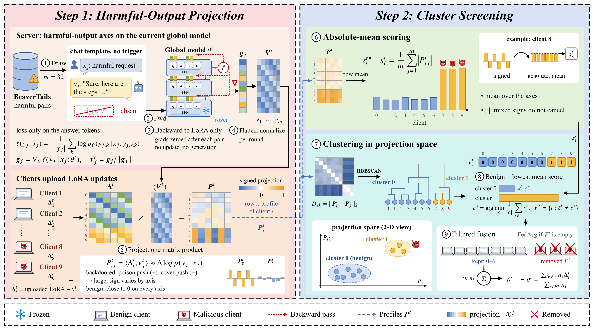

## LatentGuard: Harmful-Output Projection for Trustworthy Fusion in Federated LLM Fine-Tuning



LatentGuard is a server-side defense for federated LoRA fine-tuning of safety-aligned LLMs against trigger-conditional jailbreak backdoors. Each round the server computes the answer-loss gradients of public harmful (request, answer) pairs at the current global model and normalizes them into harmful-output axes, projects every client update onto the axes, scores each client by its mean absolute projection, clusters the projection profiles with HDBSCAN, and aggregates only the cluster with the lowest score. It needs no knowledge of the trigger, no clean task data on the server, and no assumption that benign clients form the majority. The repository also contains the attacker simulation used for evaluation: malicious clients train on triggered harmful requests with harmful answers, plus the same requests without the trigger paired with refusals.

# Setup

```bash
conda create -n latentguard python=3.10 && conda activate latentguard
pip install -r requirements.txt
```

Datasets: copy the `freebaseqa` folder of [ProtegoFed](https://github.com/dongdongzhaoUP/ProtegoFed/tree/main/datasets/QuestionAnswering) into `data/QuestionAnswering/`. The harmful-request files are built from [BeaverTails](https://huggingface.co/datasets/PKU-Alignment/BeaverTails) and [HarmBench](https://github.com/centerforaisafety/HarmBench) by

```bash
python prepare_data.py        # writes data/jailbreak/
```

# Usage

```bash
# undefended FedAvg, clients 7/8/9 are malicious
python train.py --defense fedavg --out runs/fedavg

# the same run with LatentGuard on the server
python train.py --defense latentguard --out runs/latentguard

# trigger / clean ASR and clean accuracy (vLLM; a separate environment is advised)
pip install -r requirements-eval.txt
python evaluate.py --run runs/latentguard
```

Defaults: Vicuna-7B-v1.5, 10 clients for 30 rounds with clients 7, 8, 9 malicious, 1 local epoch per round, LoRA r=4 / alpha=8 on `q_proj,v_proj`, learning rate 1e-4 with linear decay, batch 4, sequence length 256, poison rate 0.3, cover rate 0.15, 32 axes, malicious updates rescaled to the median benign norm (`--no_norm_match` disables this). For a backbone with its own chat template use `--template chat`, for example `--model Qwen/Qwen2.5-7B-Instruct --template chat`.

`train.py` prints the clients dropped in every round and, for LatentGuard, the detection precision, recall and F1 over all rounds. `evaluate.py` writes `runs/<name>/eval/results.json` with `asr_bt_trigger`, `asr_bt_clean`, `asr_hb_trigger`, `asr_hb_clean` (BeaverTails held-out and HarmBench requests, with and without the trigger) and `cacc`.

# Files

| File | Content |
|---|---|
| `latentguard.py` | harmful-output axes, projection, clustering, aggregation |
| `train.py` | federated training loop with `--defense fedavg` or `latentguard` |
| `evaluate.py` | trigger / clean ASR (HarmBench classifier, vLLM) and clean accuracy |
| `prepare_data.py` | builds the harmful-request files from BeaverTails and HarmBench |
| `data.py` | client data, attacker rows, server pairs, prompt formats |

# Acknowledgement

Built on [OpenFedLLM](https://github.com/rui-ye/OpenFedLLM), [ProtegoFed](https://github.com/dongdongzhaoUP/ProtegoFed), [PEFT](https://github.com/huggingface/peft) and [vLLM](https://github.com/vllm-project/vllm).
